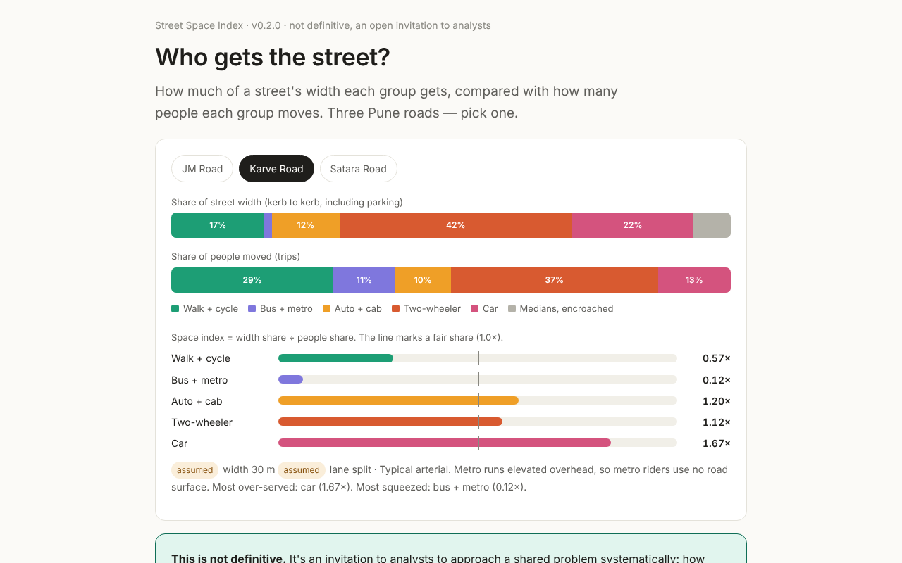

# Who gets the street? — Street Space Index

[](https://finkrishna.github.io/street-space-index/)

**▶ Try it live:** https://finkrishna.github.io/street-space-index/ — click any street, flip between "as usable today" and "as drawn", move the assumption sliders, check your own road.

> **This is not a definitive study.** It's an invitation to analysts, planners, students and curious citizens to approach a shared problem systematically: how should dense Indian cities allocate a scarce common good, street space, among the people who use it? Every number here can be checked, challenged and replaced. Better data and sharper methods are the point.

> **Standing on ITDP India's shoulders.** The Pune half of this project is built on measured data from **[Pune's Walk & Cycle Analysis](https://itdp.in/resource/punes-walk-cycle-analysis/)** by the Institute for Transportation and Development Policy (ITDP) India with Pune Municipal Corporation (PMC), December 2022. Their cross-sections, traffic counts and footpath observations are what make the Pune results real rather than guessed. [More below.](#the-itdp-india--pmc-study-this-is-built-on)

---

## The question

Every street is a fixed amount of width. Two numbers tell you who it's built for:

1. **What share of the street, usable today, serves people walking, cycling or riding a bus?** This is the headline. It's mostly measured width, so it depends little on assumptions.
2. **Space per person:** how much street a person in a car, two-wheeler or auto gets, compared with a person walking, cycling or on a bus. 1.0× is even.

## Good, bad and ugly (v0.4, streets as ITDP drew them)

| Street | City | Street for walking, cycling & buses | People who travel that way | Motor ÷ sustainable space per person | Grade | ITDP score |
|---|---|---|---|---|---|---|
| Rue de Rivoli | Paris * | **93%** (as drawn 93%) | 90% | no private-car lane | Good | – |
| Nørrebrogade | Copenhagen * | **67%** (as drawn 67%) | 73% | 1.0× | Good | – |
| Jodenbreestraat | Amsterdam * | **57%** (as drawn 57%) | 90% | 2.9× | Good | – |
| 9th Avenue (34th–50th) | New York * | **53%** (as drawn 53%) | 85% | 4.6× | Good | – |
| JM Road | Pune | **38%** (as drawn 42%) | 34% | 0.4× | Bad | 25.5/30 |
| Satara Road | Pune | **33%** (as drawn 42%) | 66% | 3.0× | Bad | 19.5/30 |
| Pune–Solapur Road | Pune | **26%** (as drawn 41%) | 41% | 1.3× | Bad | 13.5/30 |
| Nagar Road | Pune | **21%** (as drawn 28%) | 39% | 1.8× | Bad | 13/30 |
| Raj Bhavan Road | Pune | **17%** (as drawn 29%) | 30% | 1.4× | Ugly | 21/30 |
| Karve Road | Pune | **15%** (as drawn 18%) | 47% | 3.3× | Ugly | 15.5/30 |
| Shankarsheth Road | Pune | **14%** (as drawn 33%) | 39% | 2.7× | Ugly | 10.5/30 |
| Sinhagad Road | Pune | **12%** (as drawn 25%) | 18% | 1.2× | Ugly | 12.5/30 |
| Pashan Road | Pune | **11%** (as drawn 22%) | 29% | 2.5× | Ugly | 12.5/30 |
| Magarpatta–Mundhwa Road | Pune | **10%** (as drawn 19%) | 36% | 4.0× | Ugly | 7/30 |
| Vishrantwadi Road | Pune | **9%** (as drawn 21%) | 45% | 6.1× | Ugly | 8/30 |

\* World streets are **illustrative**: widths estimated from published descriptions and mode shares from city-level patterns, except Nørrebrogade, which uses published daily counts. They're there for scale, so you can look at a Pune street and think "hmm, that makes sense".
Grades: **Good** 50%+ of the street for walking, cycling and buses · **Bad** 20–50% · **Ugly** under 20%.

What stands out:

- **Every Pune street gives walking, cycling and buses less than 40% of its width.** The world reference streets all give them more than half.
- **Encroachment roughly halves what Pune has built.** Shankarsheth Road gives these modes 33% of its width on paper and 14% in practice. Pashan, Sinhagad, Magarpatta and Vishrantwadi roads lose about half too. ITDP found 30% of audited length has footpaths that exist but can't be used.
- **Vishrantwadi Road is the ugliest.** 45% of the people on it walk, cycle or ride a bus, but they get 9% of the usable street. A person in a motor vehicle gets about 6× the space.
- **JM Road is Pune's proof that it can be done.** It's the only Pune street where walkers, cyclists and bus riders get more than their per-person share. ITDP rated it best, 25.5/30.
- **New York isn't automatically "good".** 9th Avenue gives 53% of its width to walking, cycling and buses, but 85% of people travel that way. That gap is exactly why NYC DOT is redesigning it with a 9 ft "super sidewalk" in 2026.
- **Our ranking broadly agrees with ITDP's.** Theirs scores design quality, observed use and perception; ours scores only width allocation. Both put JM Road on top and Magarpatta–Mundhwa and Vishrantwadi at the bottom. They differ on Raj Bhavan Road (21/30 from ITDP, 17% here): it's well designed, but half its footpath isn't usable.

## The ITDP India & PMC study this is built on

[**Pune's Walk & Cycle Analysis**](https://itdp.in/resource/punes-walk-cycle-analysis/) was carried out by ITDP India with Pune Municipal Corporation and released on Pune's Pedestrians' Day, 11 December 2022. As far as we know, it's the most rigorous public assessment of how Pune's main streets actually work.

**What they did:**

- **Scope:** 11 streets with right of way above 24 m, about 30 km, cut into junction-to-junction segments of 0.5–1 km. Both sides were surveyed separately, at morning (9–11am) and evening (5–7pm) peaks, Oct–Nov 2022.
- **Design survey:** each street assessed against Pune's Urban Street Design Guidelines and IRC standards on ease of movement, safety, universal accessibility and liveability, with a level of service for each segment.
- **Observation survey:** volume counts of pedestrians, cyclists, cars, two-wheelers, autos, PMPML, school and private buses, and goods vehicles; pedestrian movement patterns, activity and parking mapping; infrastructure condition.
- **Perception survey:** 2,300 people interviewed, including caregivers, elderly people, people with disabilities and public-transport users.

**What it found** (summarised):

- 30% of surveyed length has footpaths that are present but unusable: parked vehicles, commercial spillover, poor surface, inadequate width, DP boxes, tree pits.
- On poorly faring streets, up to 80% of people walk off the footpath, on vehicle lanes and cycle tracks.
- Only 14% of 675 caregivers feel safe letting children walk to school unsupervised.
- 34% would definitely take up cycling with safer infrastructure, and 28% might.
- Streets built to Pune's Urban Street Design Guidelines performed better in all three surveys.

**How PMC got there.** Pune has been unusually deliberate about streets for nearly two decades:
- **2008:** a Comprehensive Mobility Plan set a 2031 goal of 90% of trips by walking, cycling and public transport.
- **Since then:** Urban Street Design Guidelines, a Pedestrian Policy, a 2017 Bicycle Plan, and annual Pedestrians' Days (Laxmi Road went car-free for a day in 2021).
- **Budget:** according to ITDP, close to half of the transport budget has gone to sustainable transport since 2016.
- **2022:** PMC proposed the assessment to check whether that spending was working.

Most cities never measure their own streets this carefully. The study deserves to be far better known.

**What we took from it, for every street:**
- the drawn cross-section, transcribed from the report's street-section diagrams
- morning plus evening peak counts of every mode
- the observed share of the stretch with a usable footpath and usable cycle track
- ITDP's 30-point score, shown alongside ours

Raw transcribed counts (AM and PM separately) are in [`data/model.json`](data/model.json) under each road's `counts._raw_am_pm`, with the report page cited in each road's `source`. Any transcription errors are ours, not ITDP's.

## Try it

- **Click any street** to see its full split: street width against people moved, mode by mode.
- **As usable today / as drawn.** Toggle between the observed usable width and what's on paper. The gap is the encroachment.
- **Adjust the assumptions.** Sliders for people per vehicle, lane space per vehicle (PCU) including goods vehicles, and parking. Every chart updates live.
- **Check your own road.** Enter any street's cross-section and your city's travel shares, then get the grade and ratio instantly. *Copy link* reproduces your road; *Ask for a deeper analysis* opens a pre-filled [request](../../issues/new?template=road-request.yml).

## Parking: the hidden width tax

Pune builds wide roads, and buildings are approved on the strength of that width. Then one lane on each side fills with office parking and another with delivery and short-stay vehicles. A wide road ends up working like a **1.5-lane squeeze**, often outside commercial buildings whose sanctioned parking sits underused. Parked vehicles move nobody, but they take width from everyone: pedestrians, two-wheelers, buses and cars.

**What's already in the numbers:** parking on footpaths and cycle tracks. ITDP found parked vehicles are a main reason 30% of audited footpath length is "present but unusable", and 1 in 4 people surveyed on several streets reported low visibility because of parked vehicles. That's inside the "as usable today" figures.

**What wasn't, until v0.4:** parking on the traffic lanes. ITDP drew the lanes clear. The site and model now have a **parked-vehicles layer**:

- Formal parking lanes and any informal parking on the carriageway are shown as their own block, *Parked vehicles*, which moves nobody.
- A slider (and `--informal M` in the Python model) sets how many metres per side of traffic lane parking takes on Indian streets. World reference streets are assumed to be enforced.
- Two new numbers: **% of the street that moves nobody** (parked plus unusable or other) and **traffic lanes on paper → lanes left for moving traffic**.

With 2.5 m of parking each side (about one lane of parked cars):

| Street | Lanes on paper → left | Street moving nobody | Motor ÷ sustainable space per person |
|---|---|---|---|
| Karve Road | 4.6 → **3.1** (≈1.5 per direction) | 30% → **48%** | 3.3× |
| Sinhagad Road | 5.5 → 4.0 | 35% → **50%** | 1.2× |
| Shankarsheth Road | 5.5 → 4.0 | 31% → 47% | 2.7× → 2.8× |
| Vishrantwadi Road | 6.9 → 5.4 | 22% → 39% | 6.1× → **7.4×** |

The headline (share of street for walking, cycling and buses) barely moves, because carriageway parking mostly eats motor-vehicle width. What changes is how much of the street moves anyone at all. Where buses share the lanes, they lose space too, so Vishrantwadi drops from 9% to 7%. On Karve Road under this scenario, every moving mode falls below its fair share, cars and two-wheelers included. Parking squeezes everyone.

**ITDP's own recommendation:** active enforcement under the parking policy, and *"Area Level Parking Plans"* with *"on-street parking operators"*, starting on the redesigned streets. A companion idea from the author, to be published separately: price kerbside parking outside commercial buildings well above the cost of their own sanctioned parking, audit and restore that internal parking, and judge operators on kerb space recovered, not revenue collected. The goal is to get the roads back, not to monetise them.

**Caveat:** a single uniform figure for every street is crude. JM Road, for one, has managed parking. Measured kerb-occupancy counts per street would replace this scenario.

## The approach

```
people(mode)      = count(mode) × occupancy(mode)              # or city mode share where no counts exist
lane share(mode)  = count × PCU ÷ Σ(count × PCU)               # shared lanes split by road space used
space(mode)       = [dedicated width × usable + lanes × lane share + parking share] ÷ total width
headline          = space(walk) + space(cycle) + space(bus/metro)
ratio             = [space ÷ people] for car, two-wheeler, auto  ÷  [space ÷ people] for walk, cycle, bus
```

- **Usable** is ITDP's observed share of the stretch with a usable footpath or cycle track. The unusable remainder is shown as "Other / unusable".
- **Buses** move out of shared lanes when a street has a bus lane. **Goods vehicles** take lane space but carry no counted people.
- **Metro and subway** riders count as people but use no road surface. That's why elevated or underground rail makes the bus-and-metro share look over-served on very little width.

## What could make this wrong

1. **Counts are taken at one point.** Walking trips are short, so fewer walkers pass any single point than vehicles on long trips. A count measures flow through the street, not everyone who uses it.
2. **Today's counts hide suppressed demand.** Pune's cycle tracks show indices of 10–50× (massively "over-served") because ITDP counted only a few dozen cyclists on 3–4 m tracks. That says the tracks are blocked or disconnected (34% would cycle if it were safe), not that cyclists have too much space.
3. **Bus occupancy drives the bus numbers.** One bus at 40 people outweighs dozens of cars. Test it with the slider.
4. **World streets are illustrative.** Only Nørrebrogade has published counts.
5. **One section per street.** ITDP drew one representative cross-section per street; real widths vary block by block. Footpath usability is the share of length, applied to width.
6. **Parking on traffic lanes isn't measured.** The parking slider is a uniform scenario, not an observation.
7. **Transcription.** Small labels on ITDP's section diagrams were read from high-resolution renders. Total widths were checked against each street's stated right of way.

## Repo layout

| Path | What |
|---|---|
| [`index.html`](index.html) | The site. Plain HTML/CSS/JS, no libraries; every bar is a `div` sized by percentage. |
| [`data/model.json`](data/model.json) | **Single source of truth:** roads, widths, counts, usability, assumptions, sources. |
| [`model/street_space.py`](model/street_space.py) | Standard-library Python implementing the same arithmetic, so every number on the site is reproducible. |
| [`.github/ISSUE_TEMPLATE/road-request.yml`](.github/ISSUE_TEMPLATE/road-request.yml) | The "analyse my road" request form. |

```bash
python3 model/street_space.py                         # ranking, as usable today
python3 model/street_space.py --as-drawn              # as drawn on paper
python3 model/street_space.py --informal 2.5          # add 2.5 m/side of parking on traffic lanes
python3 model/street_space.py --set occupancy.bus=25 --set pcu.two_wheeler=0.5
python3 model/street_space.py --road my_road.json --csv out.csv
```

A road file with counts (vehicles per period, people for pedestrians and cyclists) looks like this:
```json
{ "name": "MG Road", "city": "Bengaluru",
  "widths_m": { "footpath": 6, "cycle_track": 0, "bus_lane": 0, "carriageway": 18, "parking": 2, "other": 2 },
  "usable": { "footpath": 0.6 },
  "counts": { "pedestrians": 3000, "cyclists": 50, "cars": 2500, "two_wheelers": 6000, "autos": 900, "buses": 120, "goods": 200 } }
```
Without counts, give `"mode_share": {"walk": 26, "cycle": 3, "bus": 10, "metro": 1, "ipt": 10, "two_wheeler": 37, "car": 13}` instead.

Run the site locally: `python3 -m http.server`, then open http://localhost:8000.

## Progress

`███████████████░░░░░ 75%`

- [x] Method, city context, adjustable assumptions, check-your-road calculator, request form
- [x] 11 Pune streets from ITDP measurements (sections, counts, usability)
- [x] 4 world reference streets (Paris, Copenhagen, Amsterdam, New York)
- [x] Parked-vehicles layer: informal parking on traffic lanes, lanes left, share of street moving nobody
- [ ] Measured kerb-parking occupancy per street
- [ ] Block-by-block widths and all-day counts
- [ ] Measured cross-sections for the world streets
- [ ] More Indian cities, from your requests

## Where this came from

A [post](https://x.com/thebetterindia/status/2125237544464044524) by **[The Better India](https://x.com/thebetterindia)** about Gangtok asked: *what if Indian cities were designed for people, not just vehicles?* It showed Gangtok's footpaths with protective railings, tactile tiles, solar studs and underground utility cables. That post started this project; thank you to The Better India for highlighting the story. Checking Gangtok's 12 km retrofit (utility ducts under the footpath, so it isn't dug up again and again) led to a sharper question: before copying it, who is the street currently built for?

## Contribute

- **Analyse a road:** use *Ask for a deeper analysis* on the site, or open the [request form](../../issues/new?template=road-request.yml).
- **Improve a number:** measured cross-sections and traffic counts, with a source, replace estimates.

## Sources

Every source, with the claim it supports, is in [`data/model.json`](data/model.json) and at the bottom of the live site. Key ones:

- [ITDP India & PMC, Pune's Walk & Cycle Analysis (2022)](https://itdp.in/resource/punes-walk-cycle-analysis/) and [ITDP's write-up of the assessment](https://itdp.in/pune-streets-impact-assessment/)
- [Nørrebrogade daily counts (UrbanLEDS Copenhagen case story)](https://urban-leds.org/wp-content/uploads/2019/resources/case_studies/UrbanLEDS_case_story_Copenhagen_2015_Web.pdf)
- [Jodenbreestraat, Amsterdam (BikePortland)](https://bikeportland.org/2013/06/14/observing-jodenbreestraat-a-lively-shopping-street-in-amsterdam-88446)
- [NYC DOT 9th Avenue 34th–50th St (2026)](https://www.nyc.gov/html/dot/downloads/pdf/9th-ave-34-st-50-st-mar2026.pdf)
- [Pune RTO vehicle count (Free Press Journal)](https://www.freepressjournal.in/amp/pune/rising-vehicle-numbers-push-pune-towards-3-letter-registration-system-all-you-need-to-know)

## Licence

Code: MIT. Text and our data compilation: CC BY 4.0. ITDP/PMC data remains theirs; it's reproduced here with attribution for analysis and comment. Built by Krishna (finkrishna) with Claude.
